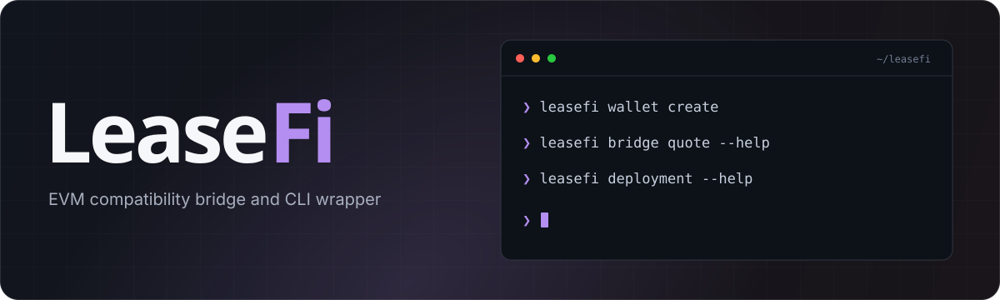

<p align="center">
  
</p>

<p align="center">
  <strong>Akash wallets, cross-chain funding, and tenant deployments. From your terminal.</strong>
</p>

<p align="center">
  <a href="https://github.com/TomasH60/leasefi/actions/workflows/test.yml"></a>
  <a href="https://github.com/TomasH60/leasefi/actions/workflows/checks.yml"></a>
  <a href="https://github.com/TomasH60/leasefi/actions/workflows/docs.yml"></a>
</p>

<p align="center">
  <a href="https://tomash60.github.io/leasefi/"><strong>Documentation</strong></a> &nbsp;·&nbsp;
  <a href="https://tomash60.github.io/leasefi/guides/tenant-setup/">Tenant setup</a> &nbsp;·&nbsp;
  <a href="https://tomash60.github.io/leasefi/guides/provider-cluster/">Provider setup</a> &nbsp;·&nbsp;
  <a href="https://github.com/TomasH60/leasefi/issues">Report an issue</a>
</p>

---

| Wallet                                               | Bridge                                                     | Deploy                                                  |
| :--------------------------------------------------- | :--------------------------------------------------------- | :------------------------------------------------------ |
| Create encrypted local wallets and inspect balances. | Quote, send, and track cross-chain routes through Skip Go. | Manage SDL, bids, leases, manifests, logs, and cleanup. |

### Start with your setup

Follow the [tenant setup](https://tomash60.github.io/leasefi/guides/tenant-setup/)
to prepare the wallet, certificate, networking, and workload. If you supply the
compute, complete the [provider setup](https://tomash60.github.io/leasefi/guides/provider-cluster/)
first. Then install LeaseFi on the tenant machine and reuse that setup to deploy.

### Install LeaseFi after setup

Requires **Node.js 22.18+ (22.x) or 24.x**.

```sh
git clone https://github.com/TomasH60/leasefi.git
cd leasefi
npm ci
npm run build
npm link

leasefi --help
```

### Explore

```sh
leasefi config show
leasefi wallet --help
leasefi bridge --help
leasefi deployment --help
```

> **In development.** Tenant commands default to `sandbox-2`. Start with the
> [deployment guide](https://tomash60.github.io/leasefi/guides/tenant-cli/) or the
> [testnet bridge walkthrough](https://tomash60.github.io/leasefi/guides/testnet-bridge/).

[Development guide](https://tomash60.github.io/leasefi/development/) · [Run the docs locally](website/README.md)

### License

LeaseFi's original code is licensed under the [MIT License](LICENSE).

LeaseFi uses the Apache-2.0-licensed Akash Chain SDK and Skip Go Client. Their
licenses and attribution are included in [Third-party notices](THIRD_PARTY_NOTICES.md).
LeaseFi is an independent project, not affiliated with or endorsed by Akash Network
or Skip Go. Dependencies retain their own licenses.
